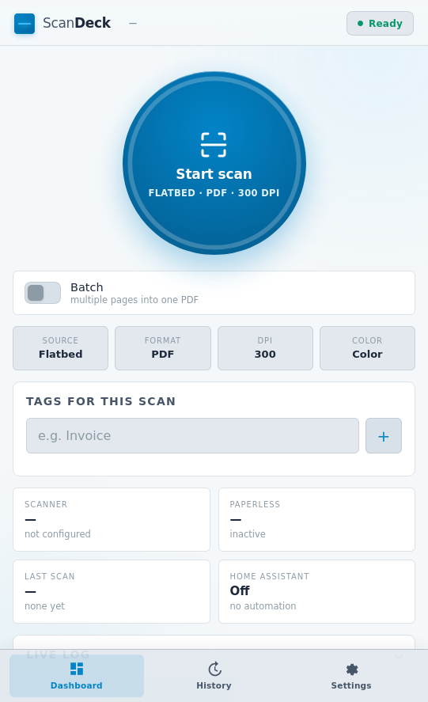
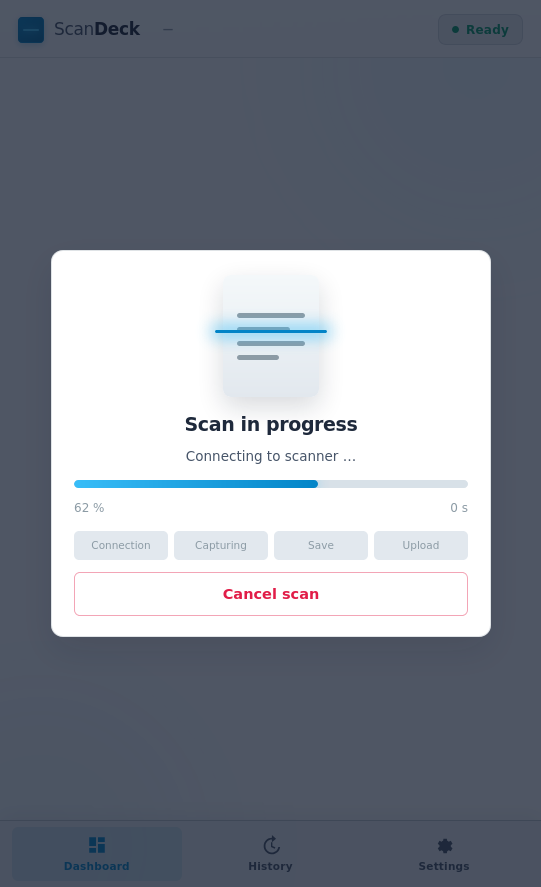

# ScanDeck

**Place document on scanner, take out your phone, tap the button — done, it's in Paperless-ngx.**

No booting up a PC, no scanning software, no USB cable, no detours through your downloads folder. ScanDeck communicates directly with your network scanner (HP, Brother, Canon, Epson — anything supporting eSCL/AirScan) and pushes the result as a PDF directly into Paperless-ngx. It is operated via a responsive web interface designed for mobile phones that feels like a native app — ready to be added to your home screen.

Your daily routine: open mail, place page on glass, tap *Start scan* on your phone, see a brief preview — and the document is tagged in Paperless. A matter of seconds instead of manual effort per letter.

Need even less friction? Trigger scans via Home Assistant buttons, NFC tags, or motion sensors. You won't even need to touch your phone.

| Dashboard | Scanning progress |
| --- | --- |
|  |  |

## Getting Started

The prebuilt image is hosted on GitHub Container Registry, built for both `amd64` and `arm64` (runs great on a Raspberry Pi). No compilation required, just pull and run.

**With Docker Compose** — download [`docker-compose.yaml`](docker-compose.yaml) and start:

```bash
docker compose up -d
```

**Or with a single docker command:**

```bash
docker run -d \
  --name scandeck \
  -p 8080:8080 \
  -v ./data:/data \
  -v ./scans:/scans \
  --restart unless-stopped \
  ghcr.io/dersumo/scandeck:latest
```

Then open `http://localhost:8080` in your browser (or use your server's LAN IP from your phone, e.g. `http://192.168.1.10:8080`).

On first start, **nothing is preconfigured** — you will be welcomed by a setup wizard that discovers scanners on your network, asks for Paperless-ngx connection details, and sets up format and tags. Once completed, only the clean scan button remains.

Configuration is saved in `./data/config.json`, scans in `./scans`. Both are volume mounts and persist across updates.

Update and stop:

```bash
docker compose pull && docker compose up -d
docker compose down
```

To build the image yourself, clone the repository and use the provided [Dockerfile](Dockerfile):

```bash
docker build -t scandeck .
```

### File Permissions

Under normal conditions you do not need to configure anything: the container starts as root, sets permissions on `./data` and `./scans` once, and drops privileges — the service runs unprivileged as UID 10001.

To own the files with a specific host user, specify user and group IDs (read them on host via `id -u` and `id -g`):

```yaml
environment:
  PUID: 1000
  PGID: 1000
```

If starting the container using `user:` in docker-compose without root privileges, the container cannot adjust folder permissions on its own. Set ownership once on the host:

```bash
sudo chown -R 1000:1000 ./data ./scans
```

If permissions are missing, ScanDeck reports it on startup in container logs and displays an error toast when saving.

## Add to Phone as an App (PWA)

The web UI is installable as a Progressive Web App: in Chrome/Android via *Add to Home screen*, in Safari/iOS via *Share → Add to Home Screen*. It runs fullscreen without browser bars, respects safe-areas, and loads offline shells. App icon shortcuts: *Scan now* and *Settings*.

For iOS to allow installation, the page must be reached via HTTPS or `localhost` — best set up behind a reverse proxy with TLS certificates on your LAN.

## Operation

**Dashboard** is focused on the daily workflow: large scan orb with progress ring, four quick switches (Source, Format, DPI, Color — each tap cycles options and saves immediately), session tags for the next scan, status tiles, and a collapsible live log.

During a scan, a progress sheet shows percentage, elapsed time, and stages (Connection → Capturing → Saving → Upload) along with a **Cancel button**. Cancellation stops the hardware job immediately so the device is free again. Cancelling means the scan did not occur — partially fed sheets are discarded so incomplete documents never reach Paperless. A running batch keeps previously collected pages. After a scan, a **10-second preview** is shown (configurable under *Settings → Output*, set `0` to disable). *Keep pinned* keeps the preview open; *Open* views the original file.

### Multi-Page Scans (Batch)

For documents with more than one page: toggle **Batch** on the dashboard. From then on, every scan is collected as a page in the batch instead of uploaded immediately. Scan page by page, inspect thumbnails in the list, and tap **Save as PDF** when done — merging them into a single PDF uploaded as one document.

Batch page actions — explained in-app via the question mark icon:

- **Drag** — touch and hold to reorder pages. If pages 1 and 2 were swapped, no need to rescan. Works on mobile touchscreens as well as desktop mouse drag.
- **↻ Rotate** — rotates page 90° clockwise. Press repeatedly to rotate further.
- **⟳ Rescan** — arms the page; the next scan replaces this page 1:1 while maintaining page order. Tap again to disarm.
- **× Remove** — removes page from batch.
- **Rotate all / Reverse order** — available when batch has 2+ pages. Feeder stacks often arrive upside down or in reverse; one tap fixes the entire batch.
- **Tap** — opens full-size view. The zoom overlay lets you browse pages with arrows and rotate, rescan or delete.

While collecting a batch, progress indicators show only three stages (no upload occurs yet). The upload step appears once the batch is closed.

Batches persist across page reloads and are synchronized across devices — scan from your phone and organize from your desktop.

Batches are always merged and output as PDF regardless of format settings. Individual pages can be mixed (scanner PDFs or JPEGs) and are standardized on merge.

### Document Feeder (ADF) & Batches

The automatic document feeder (ADF) and batch mode work seamlessly together: feed 5 sheets, and ScanDeck produces **5 individual page tiles** in the batch. Each can be moved, rotated, rescanned, or discarded individually.

This also applies when scanners deliver the entire feeder run as *one* multi-page PDF: ScanDeck splits it into individual pages before placing them in the batch. On finish, they are merged in your specified order.

If **Rescan** is armed on a page and the feeder yields multiple sheets, the first sheet replaces the armed page and subsequent sheets are inserted immediately after — subsequent pages maintain their position.

**Without** batch mode enabled, a feeder scan is merged directly into a single PDF document and uploaded as one file.

Under *Settings → Output*, you can choose **Paper size** (A4, Letter, Legal, A5) and **Duplex scan** (only available when Feeder is selected).

**Paper in feeder status:** When Feeder is chosen as source, a live indicator shows scanner status: *Feeder loaded* or *Feeder empty — please insert paper*. It updates continuously while the app is active. If paper is not recognized, it usually needs to be pushed further into the tray; ScanDeck informs you before attempting a scan rather than failing with an opaque HTTP 409 error.

Under *Settings → Device capabilities*, you can inspect reported scanner hardware limits: supported resolutions per source, printable area in millimeters, accepted paper formats, color modes, and formats.

ScanDeck queries capabilities automatically and limits UI options accordingly: flatbeds maxing out at A4 will disable Legal; feeders maxing out at 300 dpi disable 600 and 1200; scanners without duplex feeder hide the duplex toggle.

### Profiles

For recurring tasks, configure profiles: *Settings → Profiles → Add* captures current settings — source, resolution, color, format, paper size, and tags. On the dashboard, the profile appears as a one-tap button above the scan orb.

Home Assistant automations can reference profiles by name:

```yaml
rest_command:
  scandeck_invoice:
    url: "http://scandeck:8080/api/ha/scan"
    method: POST
    headers: { X-API-Key: !secret scandeck_key }
    payload: '{"profile": "invoice"}'
    content_type: "application/json"
```

### Post-Processing

Two optional switches under *Settings → Post-processing* (disabled by default):

- **Skip blank pages** — especially helpful for duplex feeder scans. Evaluates ink density excluding the outer 4% margins so dust and cover shadows do not count as content. Pages with even single lines of text are kept. Skipped pages are logged.
- **Deskew crooked pages** — straightens misaligned pages, improving Paperless OCR quality. Pages are re-rasterized; deviations under 0.4° are ignored.

### History and Queue

The **History** tab shows every scan with preview thumbnails and upload status:

- **Waiting for upload** — Paperless was unreachable. ScanDeck retries automatically with exponential backoff (30s, 2m, 5m, 15m, then hourly). No scan is lost during server restarts.
- **Processing** — file uploaded, Paperless task in progress.
- **In Paperless** — confirmed, with document ID.
- **Duplicate** — Paperless rejected file as duplicate.
- **Failed** — with error explanation from Paperless.

Each entry allows re-uploading, viewing the file, or deleting entry and file.

### Cleanup

Under *Settings → Cleanup*, enable automatic removal of local files after a retention period (default 24 hours).

Only files **confirmed** by Paperless are deleted. Documents still in queue, rejected, or duplicates are preserved.

### Extras

Under *Settings → Extras*:

- **Choose correspondent and document type when scanning** — loaded dynamically from your Paperless instance for one-off tagging before scan.
- **Quick tags** — most frequently used tags in Paperless as tap-to-add chips.
- **Prewarm scanner on app open** — queries scanner status as soon as app opens to wake hardware from sleep.

Settings manages Scanner, Paperless-ngx, Output, Default Tags, Home Assistant, and Configuration Reset.

## Push Notifications to Phone

Under *Settings → Push notifications*, enable Web Push to receive notifications as soon as Paperless files a document — even with the app closed. Requires **HTTPS** (and on iOS, adding to home screen). Keys are generated locally and stored securely on your instance.

Under *Extras*, **Sound and vibration** provides immediate local feedback on scan completion without HTTPS or push permissions.

## Home Assistant

### Recommended: MQTT

With an MQTT broker (like Mosquitto): configure *Settings → Home Assistant via MQTT* with host, credentials, and connect. ScanDeck registers automatically as a Home Assistant device with no manual `configuration.yaml` required:

| Buttons | Sensors |
| --- | --- |
| Start scan, Cancel scan | Status, Progress, Queue |
| Start batch, Save batch, Discard batch | Last scan, Feeder status, Scanning, Batch open |

### REST API

Under *Settings → Home Assistant*, enable the REST interface; an API key is generated locally.

| Endpoint | Method | Purpose |
| --- | --- | --- |
| `/api/ha/scan` | POST | Trigger scan. Optional JSON payload: `tags`, `source`, `resolution`, `color_mode`, `output_format`, `upload_to_paperless`, `title_prefix`. |
| `/api/ha/state` | GET | Status for RESTful sensors: `state` (`idle`/`scanning`/`error`), `progress`, `stage`, `last_file`, `last_error`. |
| `/api/ha/batch` | POST | Control batch: `{"action": "start"}`, `"finish"`, or `"cancel"`. |
| `/api/ha/test` | POST | Connection test. |

Authenticate via header `X-API-Key` (or `Authorization: Bearer …` or `?api_key=`).

```yaml
rest_command:
  scan_deck_scan:
    url: "http://scan-deck.local:8080/api/ha/scan"
    method: POST
    headers:
      X-API-Key: !secret scan_deck_key
      Content-Type: "application/json"
    payload: '{"tags": ["Automated"]}'

automation:
  - alias: "Scan on desk motion"
    trigger:
      - platform: state
        entity_id: binary_sensor.desk_motion
        to: "on"
    action:
      - service: rest_command.scan_deck_scan
```

Webhook callbacks back to Home Assistant can also be configured under *Webhook callback to Home Assistant* (`status`, `file`, `error`, `trigger`).

## Paperless-ngx Upload

### Performance

A scan involves three requests: query status, create scan job, download document. ScanDeck keeps the HTTPS connection alive, eliminating redundant TLS handshakes.

ScanDeck measures scan times per profile and records them in `./data/timings.json` to calculate accurate progress bar ramps and time remaining estimates.

### Searchable PDFs (OCR)

ScanDeck generates image-only PDFs from the scanner. Optical character recognition (OCR) is handled by Paperless-ngx during ingestion via OCRmyPDF/Tesseract.

Configure your desired OCR languages in your Paperless-ngx compose file:

```yaml
environment:
  PAPERLESS_OCR_LANGUAGE: eng
  PAPERLESS_OCR_LANGUAGES: eng deu
```

### Upload API

Uploads use `POST /api/documents/post_document/` with token authentication. Missing tags are created automatically if configured. See [Paperless-ngx API Documentation](https://docs.paperless-ngx.com/api/).

## Versioning

ScanDeck adheres to [Semantic Versioning](https://semver.org/). The current version is tracked in `VERSION` and documented in [CHANGELOG.md](CHANGELOG.md).

## Development

The codebase is structured in two layers: [`app.py`](app.py) handles the web server, application state, and background queues; standalone components live in [`scandeck/`](scandeck/).

| Module | Responsibility |
| --- | --- |
| [`config.py`](scandeck/config.py) | Config validation, defaults, persistence in `config.json` |
| [`escl.py`](scandeck/escl.py) | Scanner communication: capabilities, status, scan jobs |
| [`network.py`](scandeck/network.py) | Subnet probing and scanner discovery |
| [`documents.py`](scandeck/documents.py) | Previews, page splitting, PDF merging |
| [`batch.py`](scandeck/batch.py) | Batch collection and ordering |
| [`jobs.py`](scandeck/jobs.py) | Upload queue and duration timings |
| [`paperless.py`](scandeck/paperless.py) | Paperless-ngx integration and task polling |
| [`events.py`](scandeck/events.py) | Real-time event log and progress broadcast |
| [`updates.py`](scandeck/updates.py) | GitHub release checking |

Unit tests mock the scanner and run offline without hardware:

```bash
pip install -r requirements-dev.txt
pytest -q
```

## License

[MIT](LICENSE)

## Access Protection

By default, the interface is open for trusted local networks.

Under *Settings → Access protection*, set a password (min. 8 characters) to require authentication for all UI and API endpoints.

Endpoints left unauthenticated:
- `/health` — container health checks.
- Static assets and web app shell for login screen.
- Home Assistant endpoints (`/api/ha/*`) which use the independent API key.

## Security Notice

When access protection is disabled, the application does not require user authentication — Home Assistant API keys only protect `/api/ha/*`. Never expose port `8080` directly to the public internet without proper authentication and reverse proxy protection. Secrets in `./data` are stored in plaintext on disk; ensure persistent volumes are kept secure.
